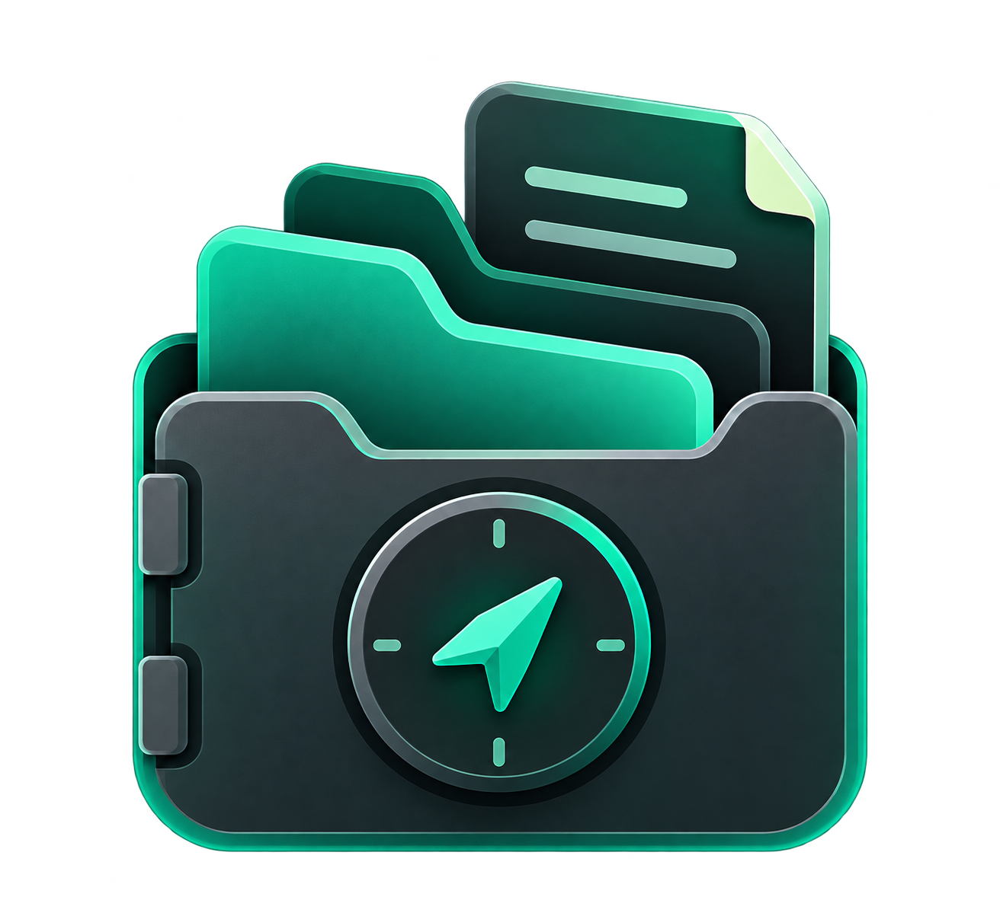
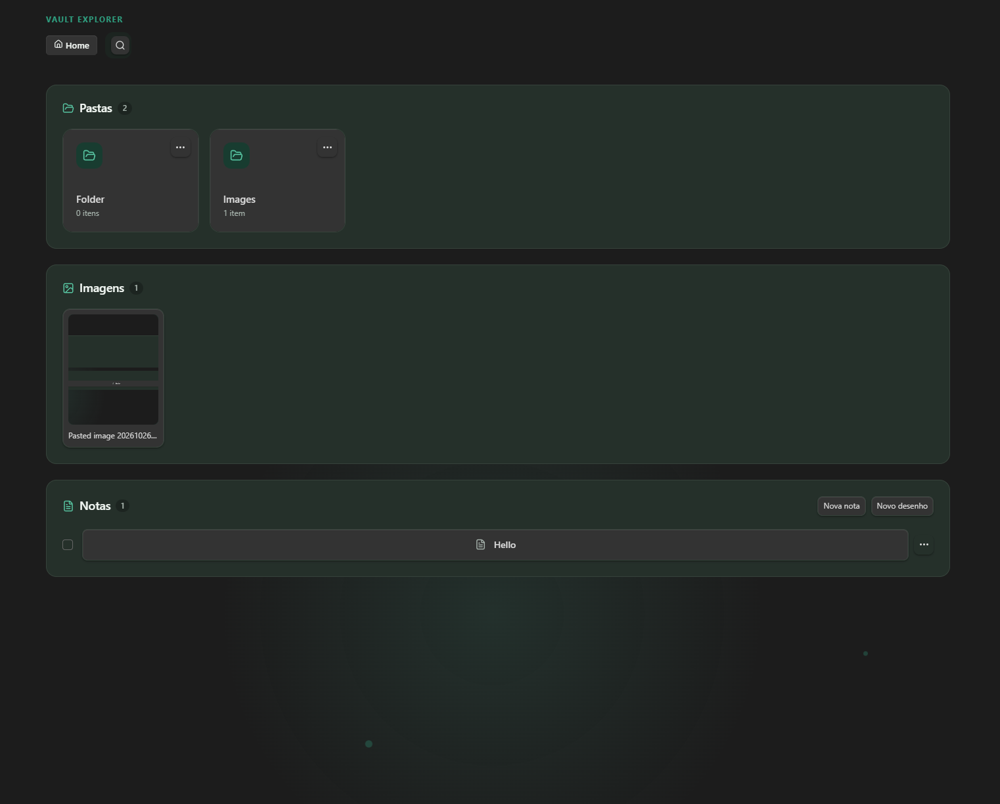
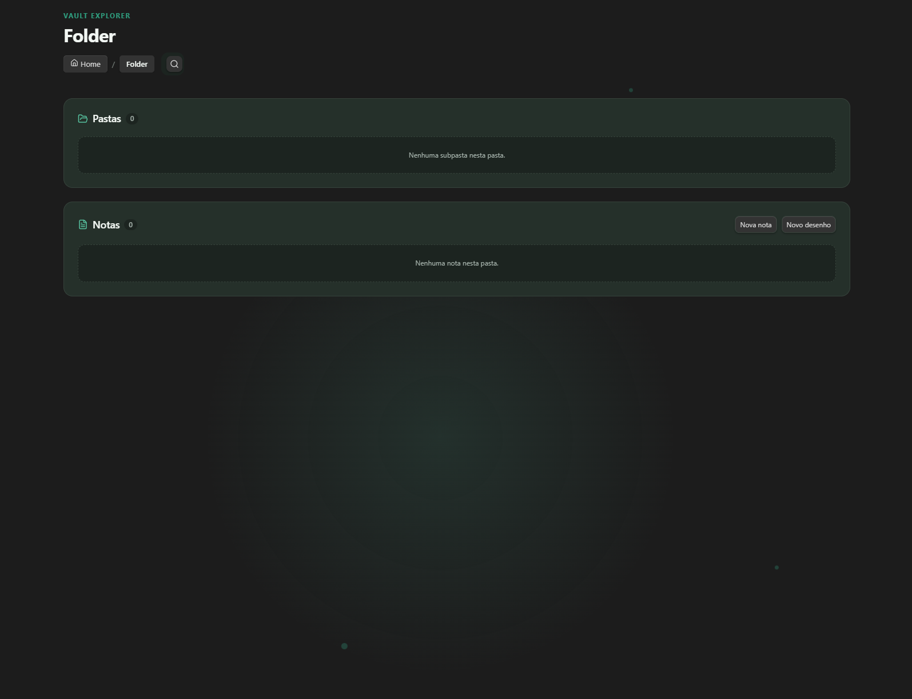
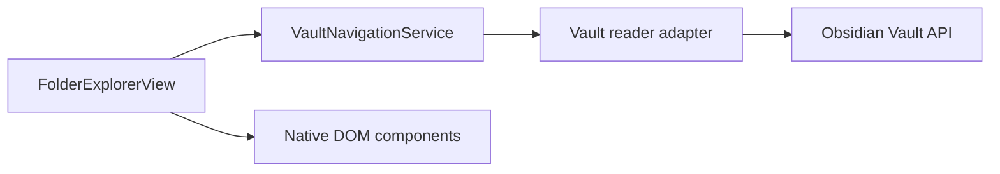

<p align="center">
  
</p>

<h1 align="center">Obsidian Folder Explorer</h1>

A local Obsidian plugin that presents the current vault location as a visual, card-based navigator. It complements rather than replaces Obsidian's built-in File Explorer.

## Features

- Navigate direct child folders through responsive cards and clickable breadcrumbs.
- Search folders, notes, and images in the current folder.
- Open Markdown notes in reading mode with a breadcrumb and creation/edit timestamps.
- Create Markdown notes and Excalidraw drawings in the current folder.
- Rename notes, select multiple notes, and move selected notes to the vault trash after confirmation.
- View direct folder images in a dedicated gallery.
- Customize folder and note icons and background colors; preferences are stored in the plugin data file and migrate with renamed paths.
- Support Obsidian light and dark themes without changing global theme styles.

## Screenshots

### Vault home



### Folder contents



## Stack

- TypeScript and the official Obsidian Plugin API
- Native DOM UI with `ItemView` and theme-aware CSS
- esbuild, ESLint, Prettier, and Vitest

## Architecture



`VaultNavigationService` is independent from Obsidian classes, so its rules are covered by unit tests. The view adapts `TFolder` and `TFile` into those rules and opens notes through the workspace API.

## Privacy and local data

The plugin runs locally and does not send vault content, file names, or appearance preferences to a remote service. Appearance preferences are saved only in Obsidian's plugin data file. The plugin never writes Markdown frontmatter to store visual settings.

## Excalidraw drawings (optional)

The **New drawing** action requires the [Excalidraw](https://github.com/zsviczian/obsidian-excalidraw-plugin) community plugin (`obsidian-excalidraw-plugin`) to be installed and enabled in the same vault.

1. Install and enable Excalidraw from **Settings → Community plugins**.
2. Open the target folder in Folder Explorer.
3. Select **New drawing** in the Notes section and provide a name.

Folder Explorer uses the documented `ExcalidrawAutomate.create()` API. The drawing is created in the folder currently displayed by the Explorer (including the vault root) and opens in a new pane, preserving the Explorer tab.

## Requirements

- Node.js 18 or newer
- An Obsidian vault for local installation

## Development

Install dependencies:

```bash
npm install
```

Compile once:

```bash
npm run build
```

Watch while developing:

```bash
npm run dev
```

Run validation:

```bash
npm test
npm run lint
```

## Install locally in Obsidian

1. Build the plugin with `npm run build`.
2. Create `<your-vault>/.obsidian/plugins/folder-explorer/`.
3. Copy `main.js`, `manifest.json`, and `styles.css` to that directory.
4. In Obsidian, open **Settings → Community plugins**, refresh installed plugins if needed, and enable **Folder Explorer**.
5. Use the ribbon folder icon or the **Open Folder Explorer** command.

## Git workflow

Keep changes small and verify them before committing:

```bash
git status
git add <files>
git commit -m "feat(explorer): add folder navigation"
```

## Known limitations

- Navigation state is not yet persisted between Obsidian sessions.
- Search and image galleries intentionally include direct children only; recursive search and history are not implemented.
- Note metadata is displayed in Reading view because it is rendered without modifying note content.

## License

This project is available under the [MIT License](LICENSE). You may use, copy, modify, distribute, and sell the software, subject to the license notice and warranty disclaimer.
